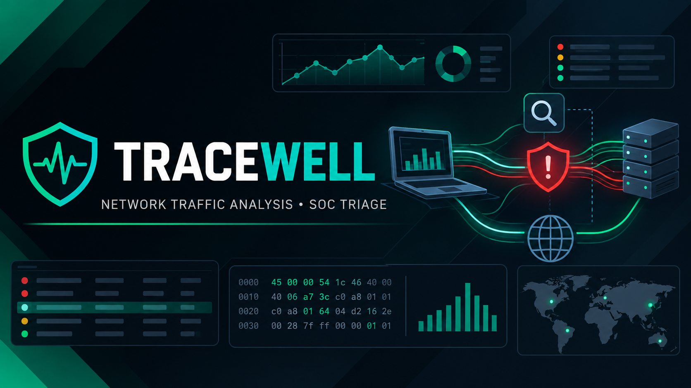
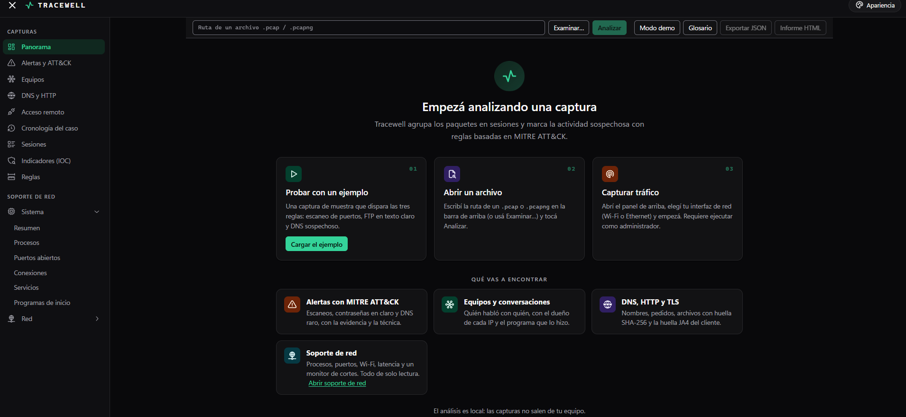
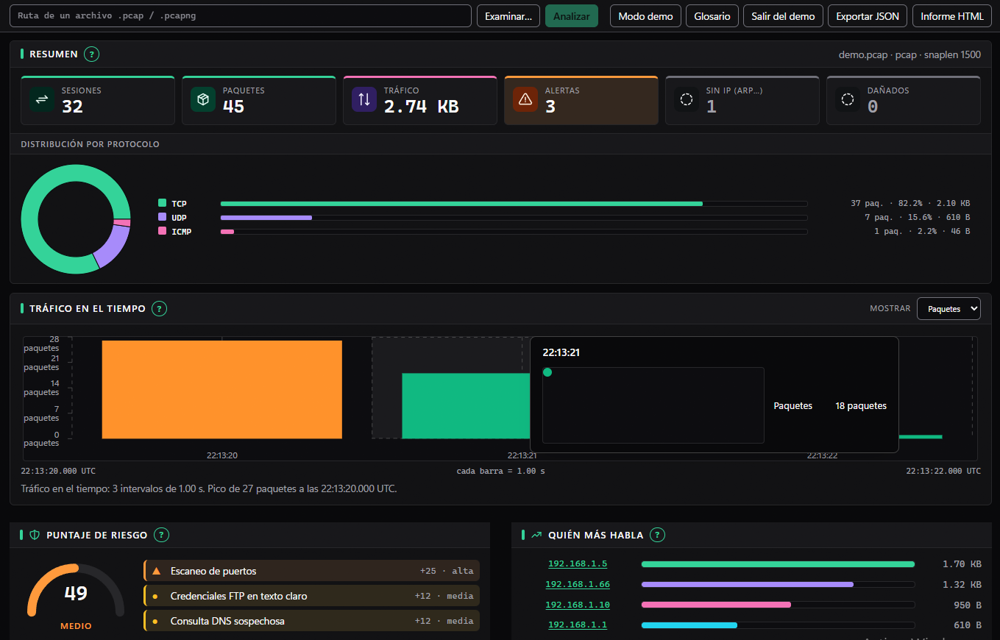
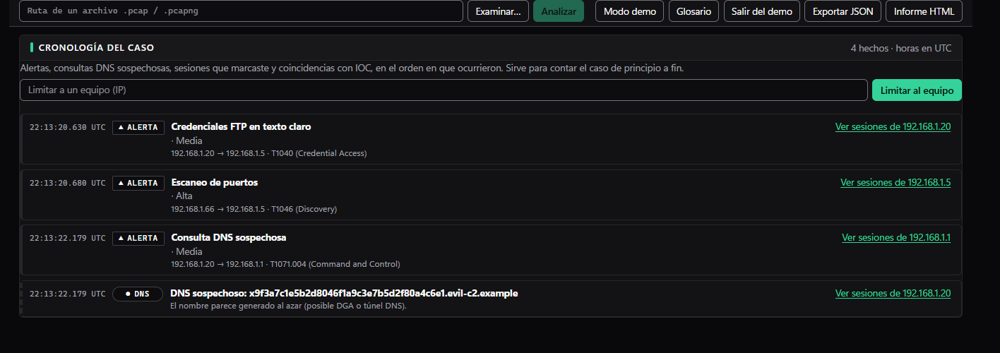

<p align="center">
  
</p>

# Tracewell

**Análisis de tráfico de red para triaje SOC.** Abrí un `.pcap` / `.pcapng` (o capturá en vivo) y Tracewell agrupa los paquetes en sesiones, aplica reglas YAML y muestra alertas con severidad, técnica MITRE ATT&CK y evidencia en una interfaz React. Es un MVP pensado para un analista SOC junior, con foco didáctico: cada pantalla explica su equivalente en Wireshark.

English version: [`README.md`](README.md). La interfaz y casi toda la documentación de `docs/` están en español; el detalle completo en inglés está en [`docs/en/`](docs/en/README.md).

## Capturas

*Pantalla de inicio: abrir un archivo, probar la demo o capturar en vivo.*



*Resumen: sesiones, volumen, alertas, distribución de protocolos, riesgo y principales hosts.*



*Cronología del caso: alertas, DNS sospechoso, sesiones marcadas y coincidencias de IOC en orden.*



## Características clave

- Lector en streaming de `.pcap` / `.pcapng` (memoria constante) y captura en vivo (Npcap / libpcap).
- **Sesiones** bidireccionales, detalle por paquete con volcado hexadecimal, seguir la conversación TCP, dirección del flujo.
- **Motor de reglas en YAML** con detectores incluidos (escaneo de puertos, FTP en claro, DNS sospechoso, beaconing, SYN flood, fuerza bruta, subidas grandes...), cada alerta con técnica ATT&CK y evidencia.
- **Herramientas de triaje:** notas y marca de "revisada", listas de IOC (texto, CSV, STIX 2.1), perfil de hosts, accesos remotos, cronología del caso, bloque "Para el ticket" en el informe HTML, filtros de Wireshark.
- Vistas HTTP, TLS y DNS; exportación a JSON / HTML / pcap.
- Módulo opcional de **soporte de red de solo lectura** (ping, ARP, Wi-Fi, monitor de cortes, IP duplicada).
- Ventana de escritorio (pywebview) o modo navegador (`--serve-only`).

Lista completa (en inglés): [`docs/en/features.md`](docs/en/features.md).

## Instalación y uso rápido

Requiere Python 3.11+ (Node.js solo para compilar la interfaz si falta `frontend/dist`).

```powershell
# Windows
powershell -ExecutionPolicy Bypass -File .\instalar.ps1
.\iniciar.ps1
```

```bash
# Linux / macOS
./instalar.sh
./iniciar.sh --serve-only     # modo navegador; ./iniciar.sh abre la ventana
```

Pulsá **demo** en la pantalla de inicio para explorar `samples/demo.pcap`. Las dependencias se instalan desde `requirements.lock` (versiones exactas con hashes). Pasos manuales y solución de problemas: [`docs/despliegue.md`](docs/despliegue.md).

## Arquitectura

```
React (Vite)  <--HTTP, token-->  FastAPI  -->  controllers (estado)  -->  domain (lógica pura)
frontend/src                     backend/api   backend/controllers        backend/domain/
                                                                          analysis, pcap, rules,
                                                                          sessions, support, export
La ventana pywebview (main.py) envuelve el mismo servidor
```

- `backend/api/` rutas HTTP y seguridad; `backend/controllers/` solo orquesta; `backend/domain/` lógica pura, un paquete por tema, cada uno con su `tests/`.
- Las reglas viven en `rules/*.yaml`: los umbrales se cambian sin tocar código.

Más: [`docs/en/architecture.md`](docs/en/architecture.md), [`docs/en/rules.md`](docs/en/rules.md), [`docs/decisiones.md`](docs/decisiones.md).

## Seguridad

- La API es para tu propia máquina: escucha solo en `127.0.0.1`, token aleatorio por arranque en cada ruta `/api`, controles de `Host` / `Origin`, CSP estricta y cabeceras de seguridad.
- El contenido del tráfico se trata como hostil (se muestra como texto, nunca como HTML); los recursos están acotados; no hay secretos en alertas ni informes.
- Dependencias fijadas con hashes. Detalle: [`docs/en/security.md`](docs/en/security.md), [`docs/desarrollo.md`](docs/desarrollo.md).

## Pruebas y calidad

Unos 4.060 tests de Python (`python -m pytest -q`) y 1.310 de frontend (`cd frontend && npx vitest run`); linters: `ruff` y ESLint. No hay CI a propósito. Ver [`docs/guia_uso_y_pruebas.md`](docs/guia_uso_y_pruebas.md) y [`docs/informe_calidad.md`](docs/informe_calidad.md).

## Documentación

- Detalle en inglés: [`docs/en/`](docs/en/README.md) (funciones, instalación, uso, arquitectura, reglas, API, seguridad, pruebas, limitaciones).
- En español: [`docs/decisiones.md`](docs/decisiones.md), [`docs/guia_didactica.md`](docs/guia_didactica.md), [`docs/despliegue.md`](docs/despliegue.md), [`docs/desarrollo.md`](docs/desarrollo.md), [`docs/guia_uso_y_pruebas.md`](docs/guia_uso_y_pruebas.md), [`docs/informe_calidad.md`](docs/informe_calidad.md).

## Licencia

Ver [`LICENSE`](LICENSE).
