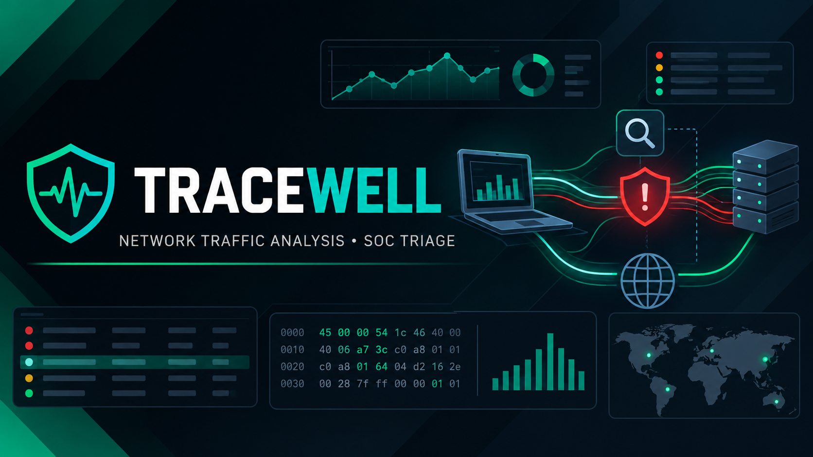
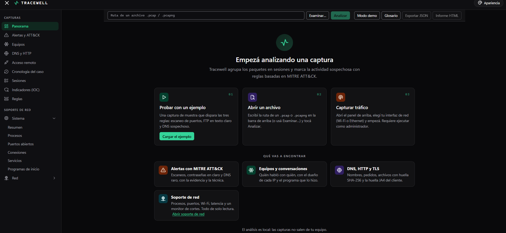
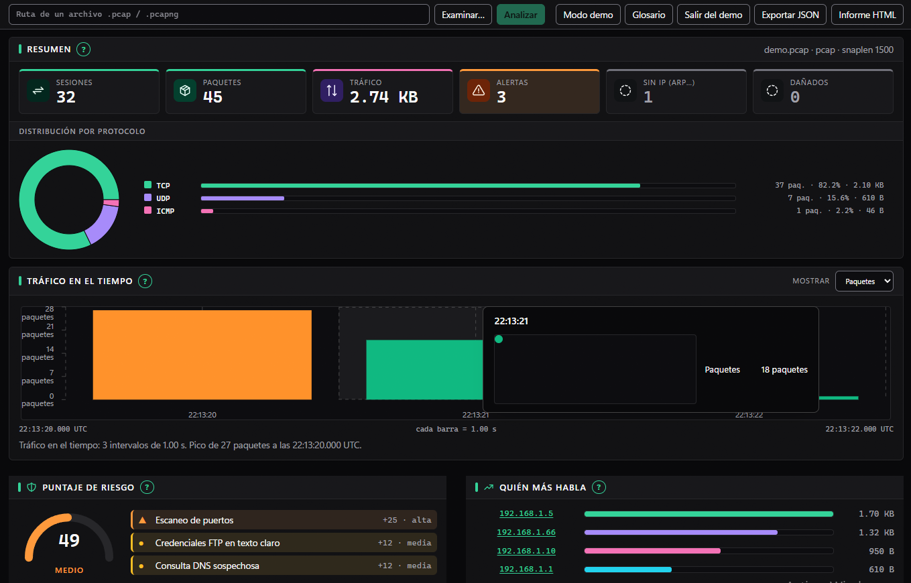
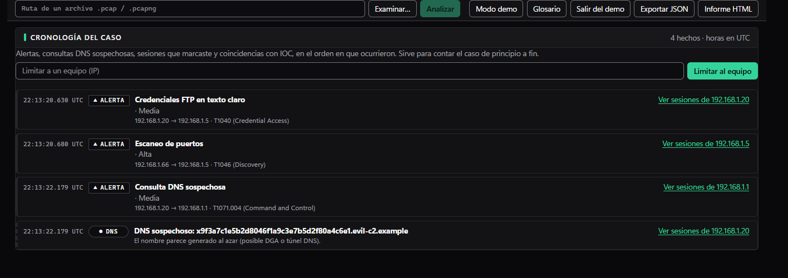

<p align="center">
  
</p>

# Tracewell

[](https://github.com/AlegreGonza/Tracewell/actions/workflows/ci.yml)

**Network traffic analysis for SOC triage.** Open a `.pcap` / `.pcapng` file (or capture live), and Tracewell groups the packets into sessions, runs YAML-defined detection rules and shows alerts with severity, MITRE ATT&CK technique and evidence in a React interface. Built as an MVP for a junior SOC analyst, with a teaching focus: every screen explains its Wireshark equivalent.

Spanish version: [`README.es.md`](README.es.md). The UI is in Spanish, and so are most `docs/` files; the English detail lives in [`docs/en/`](docs/en/README.md).

## Screenshots

*Start screen: open a file, try the demo or capture live.*



*Summary: sessions, volume, alerts, protocol distribution, risk score and top talkers.*



*Case timeline: alerts, suspicious DNS, marked sessions and IOC matches in order.*



## Key features

- Streaming reader for `.pcap` / `.pcapng` (constant memory) and live capture (Npcap / libpcap).
- Bidirectional **sessions**, per-packet detail with hex dump, TCP conversation follow-up, flow direction.
- **Rule engine in YAML** with built-in detectors (port scan, cleartext FTP, suspicious DNS, beaconing, SYN flood, brute force, large uploads...), each alert with a MITRE ATT&CK mapping and evidence.
- **Triage tools:** notes and "reviewed" marks, IOC lists (text, CSV, STIX 2.1), host profiles, remote-access view, case timeline, "For the ticket" HTML report, Wireshark display filters.
- HTTP, TLS and DNS views; JSON / HTML / pcap export.
- Optional **read-only network support** module (ping, ARP, Wi-Fi, outage monitor, duplicate IP).
- Desktop window (pywebview) or browser mode (`--serve-only`).

Full list: [`docs/en/features.md`](docs/en/features.md).

## Quick start

Requires Python 3.11+ (Node.js only to build the interface if `frontend/dist` is missing).

```powershell
# Windows
powershell -ExecutionPolicy Bypass -File .\instalar.ps1
.\iniciar.ps1
```

```bash
# Linux / macOS
./instalar.sh
./iniciar.sh --serve-only     # browser mode; ./iniciar.sh opens the window
```

Click **demo** on the start screen to explore `samples/demo.pcap`. Dependencies are installed from `requirements.lock` (exact versions with hashes). Manual steps and troubleshooting: [`docs/en/install.md`](docs/en/install.md), [`docs/despliegue.md`](docs/despliegue.md).

## Architecture

```
React (Vite)  <--HTTP, token-->  FastAPI  -->  controllers (state)  -->  domain (pure logic)
frontend/src                     backend/api   backend/controllers       backend/domain/
                                                                         analysis, pcap, rules,
                                                                         sessions, support, export
The pywebview window (main.py) wraps the same server
```

- `backend/api/` HTTP routes and security; `backend/controllers/` orchestration only; `backend/domain/` pure logic, one package per topic, each with its own `tests/`.
- Rules live in `rules/*.yaml`: thresholds change without touching code.

More: [`docs/en/architecture.md`](docs/en/architecture.md), [`docs/en/rules.md`](docs/en/rules.md), [`docs/en/api.md`](docs/en/api.md).

## Security

- The API is for your own machine: bound to `127.0.0.1`, a random per-start token on every `/api` route, `Host` / `Origin` checks, strict CSP and security headers.
- Traffic content is treated as hostile (rendered as text, never HTML); resources are bounded; no secrets in alerts or reports.
- Dependencies are pinned with hashes and the CI publishes a CycloneDX SBOM. Vulnerability reports: [`SECURITY.md`](SECURITY.md). Details: [`docs/en/security.md`](docs/en/security.md).

## Tests and quality

Python tests: `python -m pytest -q`; frontend tests: `cd frontend && npx vitest run`. The counts change with every commit, so they are not written here: see the latest run of the [CI workflow](https://github.com/AlegreGonza/Tracewell/actions/workflows/ci.yml) or measure them yourself. Checks: `ruff`, `bandit`, `pip-audit`, ESLint; `./verificar.sh` (or `.\verificar.ps1`) runs them all in order, `--linux` repeats the backend in Docker. See [`docs/pruebas.md`](docs/pruebas.md) (Spanish), [`docs/en/testing.md`](docs/en/testing.md) and [`docs/informe_calidad.md`](docs/informe_calidad.md).

## Documentation

- English detail: [`docs/en/`](docs/en/README.md) (features, install, usage, architecture, rules, API, security, testing, limitations).
- Spanish: [`docs/decisiones.md`](docs/decisiones.md), [`docs/guia_didactica.md`](docs/guia_didactica.md), [`docs/despliegue.md`](docs/despliegue.md), [`docs/desarrollo.md`](docs/desarrollo.md), [`docs/guia_uso_y_pruebas.md`](docs/guia_uso_y_pruebas.md), [`docs/informe_calidad.md`](docs/informe_calidad.md).

## License

See [`LICENSE`](LICENSE).

## Credits

The interface (`frontend/`) starts from the MIT-licensed [shadcn-admin](https://github.com/satnaing/shadcn-admin) template by satnaing (shadcn/ui, Tailwind, TanStack Router). Its license is kept in [`frontend/LICENSE-shadcn-admin`](frontend/LICENSE-shadcn-admin).
