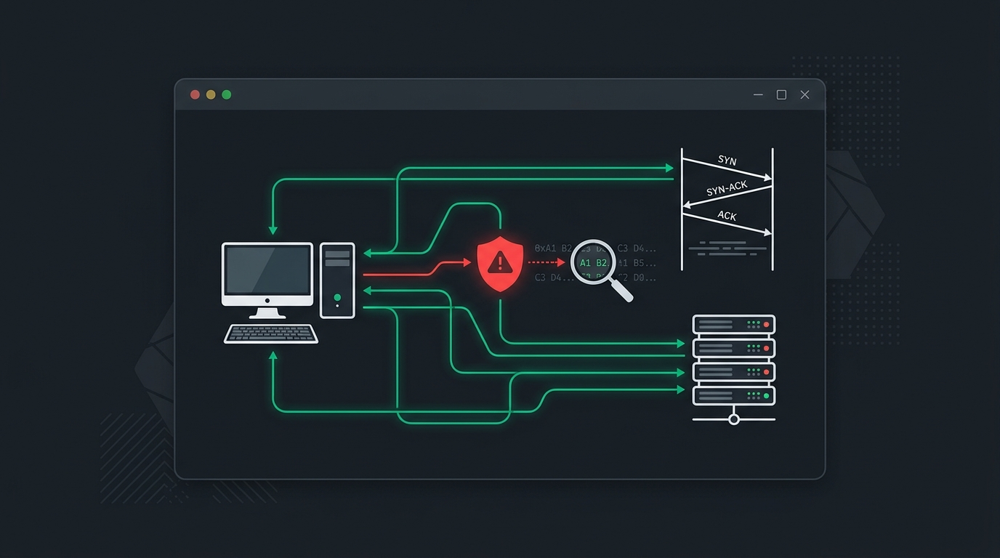

<p align="center">
  
</p>

# Tracewell

A desktop-oriented **network traffic analysis tool for SOC triage**, built as an MVP for a junior SOC analyst.

Open a `.pcap` / `.pcapng` file (or capture live from a network interface), and Tracewell groups the packets into **sessions**, runs **YAML-defined detection rules** against the traffic, and shows everything in a React interface: summary statistics, alerts with severity, MITRE ATT&CK technique and evidence, a filterable session table, and a per-packet hex dump. Results can be exported to JSON.

> **Project status.** The analysis engine, the HTTP API, the web interface, live capture and the **desktop window** (pywebview) are working and tested; `python main.py` opens the app in its own window. Tracewell is deployed **from source** with a one-command installer ([`instalar.ps1`](instalar.ps1) / [`instalar.sh`](instalar.sh)); a packaged executable was deliberately **not** built (see [`docs/despliegue.md`](docs/despliegue.md) and [`docs/empaquetado_futuro.md`](docs/empaquetado_futuro.md)). The desktop window has been validated on **Windows** and **Linux**; macOS has not been tried.

> **Language note.** The application UI and most of the documentation are in Spanish. This README is the English overview. The original Spanish version is kept as [`README.es.md`](README.es.md).

---

## Table of contents

1. [Features](#features)
2. [Quick start](#quick-start)
3. [Using the app](#using-the-app)
4. [How it works](#how-it-works)
5. [Project layout](#project-layout)
6. [Key concepts](#key-concepts-glossary)
7. [Detection rules](#detection-rules)
8. [HTTP API](#http-api)
9. [JSON export format](#json-export-format)
10. [Security and privacy](#security-and-privacy)
11. [Testing](#testing)
12. [Known limitations](#known-limitations)
13. [Roadmap](#roadmap)
14. [Further documentation](#further-documentation)

---

## Features

- Reads `.pcap` and `.pcapng` files **in streaming** (constant memory with respect to file size).
- Lists network interfaces and captures live traffic (requires administrator/root privileges; Npcap on Windows).
- **Process per session (live capture only):** a **Process** column shows which program owns each socket (for example `chrome.exe`), sampled from the operating system once per second with `psutil`. A file cannot tell which program produced a packet, so for `.pcap` files the column is not shown. Details and limits are in [Known limitations](#known-limitations).
- Groups packets into **bidirectional sessions** by IP addresses, ports and protocol.
- Filters sessions by protocol, IP address and port.
- Statistics: packets, bytes and distribution by protocol.
- Per-packet detail with a **hex dump**.
- Rule engine driven by **YAML** files. Each alert carries a severity, a MITRE ATT&CK technique and the evidence that triggered it.
- Nine built-in rules: **port scan**, **cleartext FTP credentials**, **suspicious DNS queries**, **beaconing**, **SYN flood**, **suspicious ports**, **DNS to an unusual resolver**, **large uploads** and **brute force to SSH/RDP**. You can also **create your own alerts from the interface** (a *Rules* section: protocol, source/destination IP, port and a threshold in a time window; live YAML and a preview against the open capture before saving).
- **Triage tools:** per-session notes and a "reviewed" mark, one-click jump from an alert to its sessions, an **IOC list** (IPs, networks, domains from a local file) that flags matching sessions, and a self-contained **HTML triage report** to paste into a ticket.
- **Site name per session**, taken from the capture itself (DNS responses and the TLS SNI), with no external lookups.
- **Packet detail by layers** (Ethernet, IP, TCP/UDP/ICMP, data) with a plain-language hint for every field; hovering a field highlights its bytes in the hex dump.
- **Follow the conversation** of a TCP session (like Wireshark's *Follow TCP Stream*) and a **traffic-over-time** chart.
- **Teaching first.** Tracewell exists to lower the barrier that makes Wireshark intimidating: a **?** help button on every section with the *Wireshark equivalent*, a searchable **glossary**, a plain-language **"In simple words"** explanation of every session with a **connection diagram** (SYN → SYN+ACK → ACK → data → FIN), a guided case built on the demo, and a [Wireshark ↔ Tracewell equivalence table](docs/guia_didactica.md) (in Spanish).
- **Understand the capture:** a **MITRE ATT&CK map** of your alerts (only the five tactics that show up in network traffic: reconnaissance, discovery, lateral movement, command and control, exfiltration; an alert of any other tactic gets an extra column, it is never hidden), a **hosts** view with a "who talks to whom" graph (an icon per host type, and the range owner such as Google or Cloudflare from a small offline table, shown as a hint and never overriding names found in the capture), a **DNS** table (NXDOMAIN, random-looking names), a plaintext **HTTP** analyzer that extracts files and reports their **SHA-256** and real type, and **TLS** details with the **JA4** client fingerprint and the server certificate (TLS ≤ 1.2).
- **Network support → System (read-only):** a separate screen, reachable from the top menu, that shows the machine Tracewell runs on: resource summary, running processes (RAM, CPU, path, parent, connections, SHA-256 and code signature on demand), open ports with who can reach them, active connections with the program that owns each one, services and startup programs. It never changes anything: there is no kill/disable button and every route is a `GET`. Windows and Linux; the Linux paths are not tested on a real Linux machine.
- **Network support → Network (read-only):** network configuration, a layer-by-layer *Is the Internet down?* check, latency, devices on the local network (with vendor by MAC when `data/oui.csv` is provided), Wi-Fi status and disconnection history, a background **outage monitor** with a timeline, and small tools (ping, continuous ping, traceroute, port check, RDP reachability, clock offset, duplicate IP). Nothing changes the machine: when a problem is found the fix is shown as text only. Tests that reach out (Internet check, latency, clock) run only when you press their button.
- **Take it with you:** download just one session (or an IP's traffic) as a new `.pcap` for Wireshark or a ticket.
- **Wireshark display filters:** a **Copy Wireshark filter** button on every session and every alert (`ip.addr`/`ipv6.addr` plus `tcp.port`/`udp.port`; for alerts it is derived from the evidence: scanned ports, DNS name, destination port, or the victim of a SYN flood). `GET /api/wireshark-filter?ip=` gives the filter for an IP.
- **"For the ticket" block in the HTML report:** plain, copyable text with an executive summary, a chronological timeline of alerts and marked sessions, confirmed IOC matches, key evidence and a containment suggestion. Values from the traffic are collapsed to one line and HTML-escaped.
- **IOC import from CSV and STIX 2.1:** besides one indicator per line, a CSV/TSV with a value column (`value`, `valor`, `indicator`, `ioc`, `ip`, `domain`...) or a STIX 2.1 JSON bundle (`ipv4-addr`, `ipv6-addr`, `domain-name`, `network-traffic` indicators). The format is detected from the extension or the content, and the same validations apply (a `/0` network is rejected, misspelled IPs fail with the line or object).
- **Explain-why fields in rules:** optional `false_positives`, `investigation_steps` and `wireshark_filter` in a rule YAML, shown in the alert detail (`port_scan.yaml` is the example). They are never part of the JSON export.
- **Flow direction:** every session is labeled *Internal→External*, *External→Internal*, *Internal→Internal (lateral)* or *External→External* (and *Multicast*), client → server, correcting a reversed origin when a capture starts mid-conversation.
- **Host profile:** inferred roles per host (DNS client, web server, scan sender, top talker), using only what the capture shows, and **grouping by MAC address** (several IPs on one MAC are shown together, with a hint: dual-stack, or a router/NAT).
- **Remote access:** a section grouping SSH, Telnet, SMB, RDP, WinRM and VNC sessions by service, with RST packets and repeated SYNs (retries) highlighted. `GET /api/remote-access?service=`.
- **Case timeline:** alerts, suspicious DNS queries, marked sessions and IOC matches in one chronological thread, optionally limited to one host. It is a new view; the packets-per-interval chart is unchanged.
- Exports the analysis to JSON.
- **Demo mode** with a bundled synthetic capture (32 sessions, 3 alerts) that triggers the port scan, cleartext FTP and suspicious DNS rules.

**Out of scope for the MVP:** device discovery, asset inventory, PDF reports, code signing.

---

## Quick start

### One-command install (recommended)

Windows 10/11 (PowerShell, from the project folder):

```powershell
powershell -ExecutionPolicy Bypass -File .\instalar.ps1
```

```powershell
.\iniciar.ps1
```

`instalar.ps1` detects what is missing and installs it **after asking you** (Python 3.12, Node.js only if `frontend\dist` is missing, and the WebView2 runtime, all through `winget`), creates `.venv`, installs `requirements.txt` and runs the window self-test. It can be run again safely: anything already in place is skipped. Useful switches: `-Check` (report only, installs nothing), `-Yes` (no questions), `-Dev` (also install test dependencies), `-SkipTest`. It does **not** install Npcap (live capture only; its license does not allow silent installs) and does not change any system setting, including the PowerShell execution policy.

Linux / macOS:

```bash
./instalar.sh
```

```bash
./iniciar.sh --serve-only
```

Full details, requirements and troubleshooting: [`docs/despliegue.md`](docs/despliegue.md) (in Spanish). The manual steps below do the same thing by hand.

### Download only the app (no tests)

If you just want to **use** Tracewell, you do not need the tests or the interface source code. Download the `tracewell-<version>.zip` attached to a release (it contains only what is needed to run the app, about 170 KB, with the interface already built), unzip it and run the installer as shown above. You do **not** need Node.js or the development dependencies. Verify the download with the `.sha256` file published next to it.

Maintainers build that zip from the full repository with:

```powershell
powershell -ExecutionPolicy Bypass -File .\crear_zip.ps1
```

It writes `release\tracewell-<version>.zip` (and its checksum) and does not modify the project. The full repository is only needed to develop or to run the tests (`-Dev`).

### Requirements

| Requirement | Notes |
|---|---|
| Python **3.11+** | Developed and tested on 3.12. |
| Node.js | Only needed to **build the web interface**. Tested with Node 24. |
| Npcap (Windows) or libpcap (Linux) | Only needed for **live capture**. Not needed to analyze files. |
| WebView2 runtime (Windows) | Used by the **desktop window**. It ships with Windows 11 and up-to-date Windows 10. On Linux, pywebview needs GTK/WebKit or Qt (the window was tested on Linux). Not needed with `--serve-only`. |

### 1. Create a virtual environment and install the Python dependencies

Windows (PowerShell):

```powershell
python -m venv .venv
```

```powershell
.\.venv\Scripts\python -m pip install dpkt pyyaml fastapi uvicorn scapy pywebview
```

Linux / macOS:

```bash
python3 -m venv .venv
```

```bash
.venv/bin/python -m pip install dpkt pyyaml fastapi uvicorn scapy pywebview
```

The same dependencies are listed in `pyproject.toml`. Development-only packages (tests) are installed separately:

```bash
.venv/bin/python -m pip install pytest pytest-cov httpx2 ruff
```

*(On Windows use `.\.venv\Scripts\python` instead of `.venv/bin/python`.)*

### 2. Build the web interface

```bash
cd frontend
npm install
npm run build
```

This produces `frontend/dist/`, which the API serves as static files. If you skip this step the API still works, but there is no interface at `/`.

### 3. Run Tracewell

From the project root, one command opens Tracewell in its own desktop window:

```powershell
.\.venv\Scripts\python main.py
```

Click **Demo mode** to see the three rules fire. Closing the window shuts everything down: the API stops, a running live capture is stopped, and temporary files are deleted.

Other ways to start it:

| Command | What it does |
|---|---|
| `python main.py` | Opens the desktop window (default). |
| `python main.py --serve-only` | No window: starts the API and the interface and prints a `http://127.0.0.1:<port>` address to open in your browser. Stop it with `Ctrl+C`. |
| `python main.py --port 8000` | Uses a fixed local port instead of letting the system pick a free one. |
| `python main.py --self-test` | Opens the window **hidden**, checks that the interface loads, that the native file picker is available and that demo mode works, prints a JSON result and exits (code `0` = everything OK). |

In the desktop window the **Browse…** button opens the system file dialog; in a browser you type the path instead.

> **The API only listens on `127.0.0.1`.** It can read files from your machine (see [Security and privacy](#security-and-privacy)); never expose it to your network.

Interactive API documentation (generated by FastAPI) is available at `/docs` on the printed address when you use `--serve-only`.

You can also run the API on its own, without `main.py`:

```powershell
.\.venv\Scripts\python -m uvicorn backend.api.app:create_app --factory --host 127.0.0.1 --port 8000
```

---

## Using the app

**Analyze a file.** Type the full path of a `.pcap` or `.pcapng` file in the top bar and press *Analyze*. Opening another file replaces the current analysis.

**Demo mode.** Loads `samples/demo.pcap`: 45 synthetic packets with normal DNS/HTTP/ICMP/ARP traffic plus a port scan, an FTP login and a tunnel-like DNS query. It triggers three of the nine rules (port scan, cleartext FTP and a suspicious DNS query), so you get 3 alerts and 32 sessions to explore.

**Summary.** Sessions, packets, traffic volume, alerts, and the protocol distribution. Packets that belong to no session (ARP and similar) and damaged packets are **always shown**, even when zero, so the totals never hide traffic.

**Alerts.** One row per alert with severity (text *and* color), source → destination, and timestamp. Expand a row to see the description, the MITRE ATT&CK technique (linked to attack.mitre.org) and the **evidence** as plain text. If the rule defines them, the detail also shows **possible false positives** and **how to investigate it**, and a **Copy Wireshark filter** button copies a display filter derived from the evidence (paste it in Wireshark with the `.pcap` open to see the same packets).

**Sessions.** Filter by protocol, IP and port, then press *Filter*. Filters apply on submit, not on every keystroke. An invalid filter shows an error; it is never presented as "no results". Each session shows its **direction** (Internal→External, External→Internal, Internal→Internal (lateral), External→External, from client to server). Click a session id to open its packets and the hex dump of any packet; its detail also has **Copy Wireshark filter**.

**Live capture.** Open the *Live capture* panel, choose an interface and press *Start*. Press *Stop and analyze* when done: the captured traffic is saved to a temporary `.pcap`, then analyzed exactly like any other file. Defaults protect your disk: at most **1,000,000 packets**, **10 minutes** and **200 MB** per capture.

**Traffic over time.** A bar chart of packets (or bytes) per interval, with the peak called out in text. Spikes, silences and regular rhythms stand out.

**Jump from an alert.** Expand an alert and press *Ver las sesiones de [IP]* (see the sessions of [IP]) to filter the sessions table by that source IP.

**Site name.** When a session has a known name (from a DNS answer or the TLS server name in the capture) a **Site** column appears. It is a hint, not proof: a shared IP (CDN) can serve many names, and with encrypted DNS or ECH the name is not visible.

**Packet layers.** Selecting a packet shows its hex dump and a layer tree below it. Hover or focus a field to highlight its bytes; click to pin the highlight. Hints such as "TTL 128: typical of Windows" are indicative, not proof.

**Follow the conversation.** For a TCP session, *Ver la conversación* (view the conversation) rebuilds what each side said, in order, dropping retransmissions and marking missing bytes. With plaintext protocols (FTP, HTTP, Telnet) it shows the content as is, **passwords included**, just like Wireshark. TLS sessions are reported as encrypted.

**Triage.** In a session's detail you can write a note and mark it *reviewed*; the table shows a ✓ and a *nota* tag. Notes live only in memory for the current analysis (they are not written to disk and disappear when you open another capture). The **Indicators (IOC)** panel loads a local file and matching sessions get an **IOC** badge. Three formats are accepted and detected automatically: a text file with one IP, CIDR network or domain per line (`#` for comments); a **CSV/TSV** with a value column (`value`, `valor`, `indicator`, `ioc`, `ip`, `domain`...); or a **STIX 2.1** JSON bundle (indicators on `ipv4-addr`, `ipv6-addr`, `domain-name` and `network-traffic`). Domains are matched against the site names above.

**Hosts.** One row per IP with its traffic, peers, services and alerts, plus the "who talks to whom" graph. Each host shows inferred **roles** (DNS client, web server, scan sender, top talker), based only on what this capture shows. A second card, **Equipos por MAC** (hosts by MAC), groups local-network IPs that share a MAC address: several IPs on one MAC may be one machine (IPv4 + IPv6) or a router/NAT.

**Remote access.** Sessions to SSH (22), Telnet (23), SMB (445), RDP (3389), WinRM (5985/5986) and VNC (5900), one table per service, with who connected to whom, how many connections were reset (**RST**) and how many were **retried** (repeated SYN). Highlighted rows are worth a look, for example a rejected login attempt or brute force. They are hints: an RST can also be a closed port.

**Case timeline.** Alerts, suspicious DNS queries, the sessions you marked or annotated and IOC matches in one chronological list (UTC), to tell the story of a case from start to finish. Limit it to one host with the IP box. This is different from the *Traffic over time* chart, which only counts packets.

**Rules.** Creates a new alert without writing YAML by hand. Pick a name, a severity and a description, optionally filter by protocol, source IP or network (CIDR), destination IP or network and destination port, and set a threshold (how many events in how many seconds). The page shows the **YAML** it will write, updated as you type, and, if a capture is open, **how many sessions and alerts the rule would give on it** before you save (the open capture does not change). *Load an example* fills the form with a sample case. *Save rule* creates a new file in `rules/` with the same format as the built-in ones; **it never modifies or disables an existing rule** (an id or file that already exists is rejected) and it applies from the next capture you open.

**Leaving a capture.** With something loaded, the toolbar shows **Salir del demo** (leave the demo) or **Cerrar captura** (close capture) for any other analysis. It discards the analysis, on the server too, and returns to the start screen; the IOC list is kept, notes are dropped. In the desktop window, downloads (*Export JSON*, *Informe HTML*) open the system **Save as** dialog (pywebview cancels downloads unless `ALLOW_DOWNLOADS` is enabled, which `main.py` does).

**Table colors.** Protocols get a colored tag (TCP, UDP, ICMP), each process gets its own color dot (assigned in order of first appearance, so the first eight never share a color), rows that match an IOC are tinted red and reviewed rows are dimmed. The text is always shown: color only helps, it is never the only signal.

**Export.** *Export JSON* downloads a report of what you are currently looking at (active filters are included). *Informe HTML* downloads a single-file triage report (alerts with evidence, IOC matches, your notes and the heaviest sessions) with everything escaped and no scripts, meant for a ticket. Its **"For the ticket"** block is plain text you can select and paste into the ticket: executive summary, timeline, confirmed IOC matches, key evidence and a containment suggestion. Reports can contain sensitive data: share them carefully.

**Timestamps** are shown in **UTC**, so captures can be correlated with logs from other systems without ambiguity.

---

## How it works

```
 .pcap / .pcapng file ─────────┐
                               ▼
 live capture (Scapy) ──► writes a .pcap ──► reader (dpkt, streaming)
                                                  │  yields one packet at a time
                              ┌───────────────────┴───────────────────┐
                              ▼                                       ▼
                    sessions (grouper)                       rules engine (YAML)
                    one summary per flow                     alerts + evidence
                              └───────────────────┬───────────────────┘
                                                  ▼
                                          analysis (orchestrator)
                                                  ▼
                              HTTP API (FastAPI) ──► React UI / JSON export
```

### Design rules

The project follows a three-layer layout, one folder per layer:

- **View** (`frontend/`): the React interface. It only shows data and calls the API.
- **Controller** (`backend/controllers/`): the use cases. They hold the current analysis, orchestrate the domain and decide what to return. They know nothing about HTTP routes.
- **API** (`backend/api/`): the FastAPI layer. Routes validate the shape of a request, call a controller and translate the result or the error to HTTP.
- **Domain** (`backend/domain/`): plain Python analysis logic (pcap reading, sessions, rules, TLS, system and network checks).

1. **`backend/domain/` never imports FastAPI or React.** It can be tested without a server and reused from a CLI or a desktop window.
2. **`backend/api/` only translates.** No analysis logic lives there.
3. **Controllers sit between them.** A route calls a controller; a controller calls the domain. (Shortcut kept on purpose: controllers raise `HTTPException` for "not found / conflict" cases instead of defining their own error types.)
4. **Tests live inside each module**, in its own `tests/` folder.
5. **Live capture is isolated** in `backend/domain/pcap/live.py`. It produces an ordinary `.pcap`, so everything downstream needs no special code. It is **never tested against a real network in CI**: tests use a simulated interface, and real validation is done by hand with [`docs/checklist_hardware.md`](docs/checklist_hardware.md).
6. **Minimal dependencies**, each one justified in [`docs/decisiones.md`](docs/decisiones.md).
7. **Small functions.** Every function does one thing, or two at most, and stays around 20 lines. A long function is split into small helpers that it calls; repeated patterns live in a single shared function.

### Why memory stays flat

Packets are read one at a time (Python generators). Only a small summary per *session* is kept in memory (~640 bytes each), never the packets themselves. Measured on synthetic captures, a 20× larger file with a similar number of sessions raised peak memory only from ~0.4 MB to ~1.2 MB. Memory grows with the number of **sessions**, so there is a cap (500,000 sessions); beyond it, new sessions are dropped and the UI shows a **partial analysis** warning.

---

## Project layout

```
tracewell/
├── main.py                       # desktop entry point: starts the API and opens the pywebview window
├── iniciar.ps1 / .sh             # run from source          instalar.ps1 / .sh   # first-time setup
├── backend/
│   ├── api/                      # API layer (FastAPI): translates HTTP <-> controllers
│   │   ├── app.py                # create_app(): assembles the app, nothing else
│   │   ├── server.py             # runs the API in a thread on a free 127.0.0.1 port
│   │   ├── security.py           # Host/Origin protection (DNS rebinding, cross-site requests)
│   │   ├── errors.py             # exception -> HTTP status table
│   │   ├── routes/               # one thin router per area: analysis, live, triage, insights, system, support
│   │   └── tests/
│   ├── controllers/              # use cases: current analysis, orchestration (no HTTP routing)
│   │   ├── state.py              # the one current analysis and the shared context
│   │   └── analysis.py live.py triage.py insights.py
│   └── domain/                   # pure Python. No FastAPI, no React. Each package has its own tests/
│       ├── pcap/                 # streaming reader, hexdump, layers, live capture, process sampler
│       ├── sessions/             # packets -> bidirectional sessions; filters and statistics
│       ├── analysis/             # analyzer, hosts (roles, MAC groups), DNS and name book, HTTP, TLS/JA4, explain, timeline,
│       │                         # wireshark_filter, direction, remote_access, case_timeline
│       ├── rules/                # YAML rule engine, extra detectors, IOC list
│       ├── export/               # JSON export, HTML report, pcap export
│       ├── system/               # read-only view of this machine (processes, ports, services)
│       └── support/              # read-only network checks (internet, latency, devices, Wi-Fi, outage monitor)
├── frontend/                     # View layer: React 19 + Vite + Mantine (builds to frontend/dist)
│   └── src/
│       ├── App.jsx               # shell: header, sidebar (Captures / Network support) and the screens
│       ├── tokens.css            # design tokens: 3 palettes (emerald, violet, terracotta), light and dark
│       ├── theme.js              # Mantine theme built from the chosen palette
│       ├── views/                # full screens: CapturesView (one section at a time), SupportView
│       ├── components/           # captures/ (analysis widgets), support/ (system and network), common/
│       ├── controllers/          # hooks: useLoad, useAction, usePalette
│       ├── api/                  # HTTP client (client.js)
│       └── lib/                  # formatters and help texts
├── rules/                        # YAML detection rules
├── samples/                      # demo.pcap and generate_demo.py (synthetic traffic)
├── docs/                         # decisiones.md, guia_didactica.md, checklist_hardware.md, ... (Spanish)
└── pyproject.toml, requirements*.txt, crear_zip.ps1
```

Each package under `backend/` has its own `tests/` folder; frontend tests sit next to the component they test.

---

## Key concepts (glossary)

**pcap / pcapng** — File formats that store captured network packets. A `.pcap` has one *global header* (format, link type, snaplen) followed by a small header plus raw bytes for every packet. `.pcapng` is the newer, block-based format. Tracewell detects the format from the file's *magic number*, not from its extension.

**Session (flow)** — A conversation between two endpoints, identified by the *5-tuple*: source IP, source port, destination IP, destination port and protocol. Sessions are **bidirectional**: the request and its reply belong to the same session, because the two endpoints are sorted when building the key. The "source" of a session is whoever sent the first packet *seen* (if the capture starts mid-conversation, that may not be the real client).

**caplen / origlen / snaplen** — `origlen` is the packet's size on the wire; `snaplen` is the limit the capturing tool was configured to keep; `caplen = min(origlen, snaplen)` is what was actually saved. If `caplen < origlen` the packet was **truncated by snaplen**: the file is healthy, but the payload is incomplete, so a rule that looks for text in it may miss something that was on the wire. Tracewell flags those packets. A file that is cut short (fewer bytes than `caplen`) is a different case: it is reported as a damaged file.

**MITRE ATT&CK** — A public knowledge base of attacker techniques. Each alert references a technique id (for example `T1046` – Network Service Discovery) so analysts can speak a common language.

**Shannon entropy** — A measure of how "random" a string looks (bits per character). Names that carry encoded data, such as DNS tunnels or algorithmically generated domains (DGA), tend to have high entropy.

**SYN scan** — A port scan that sends TCP SYN packets (connection attempts) to many ports. Normal conversations touch few ports.

---

## Detection rules

A rule is **data** (a YAML file) and a **detector** is **code**. The YAML sets the name, severity, MITRE technique and thresholds; the detector (Python) knows how to look for the pattern. You can tune thresholds without touching code, and a file can never execute code (`yaml.safe_load`).

### Built-in rules

| Rule id | What it detects | Severity | MITRE technique |
|---|---|---|---|
| `port_scan` | One source sends pure TCP SYN packets to ≥ `min_ports` distinct ports of the same destination within `window_seconds`. One alert per source/destination pair. | high | T1046 – Network Service Discovery |
| `ftp_cleartext` | `USER` / `PASS` commands travelling unencrypted on FTP ports. **The alert never stores the password**, only its length. | medium | T1040 – Network Sniffing |
| `dns_suspicious` | DNS queries whose first label is very long, or long *and* high-entropy (typical of tunneling or DGA). | medium | T1071.004 – Application Layer Protocol: DNS |
| `beaconing` | Connection attempts (TCP SYN) or UDP datagrams to the same destination at very regular intervals (`min_events`, `min_interval_seconds`, `max_jitter`). Intervals shorter than `min_interval_seconds` (such as a 1 s keep-alive) and regular-by-design ports (DNS, NTP, mDNS...) are ignored. | medium | T1071 – Application Layer Protocol |
| `syn_flood` | At least `min_syns` pure SYN packets to one destination and port within `window_seconds`. | high | T1498 – Network Denial of Service |
| `suspicious_ports` | A connection attempt (SYN) to a port used by common attack tools or backdoors (`ports`, default 4444, 31337, 1337, 12345, 54321, 9001). Replies are ignored so an ephemeral port that happens to match does not alert. | medium | T1571 – Non-Standard Port |
| `dns_unusual_resolver` | DNS queries sent straight to a public server that is not in `allowed_resolvers` (private destinations are always considered normal). Add your ISP's or company's resolver to the list. | low | T1071.004 – Application Layer Protocol: DNS |
| `brute_force` (rule `brute_force_remote`) | At least `min_attempts` pure SYN packets from one source to the same destination on SSH (22) or RDP (3389) (`ports`) within `window_seconds`. Each login attempt opens a new connection, so many in a short time look like password guessing. It does not see whether a login failed (the traffic is encrypted). One alert per source, destination and port. | high | T1110 – Brute Force |
| `threshold` | The rule type that the **Rules** section creates: at least `min_events` events that match a filter (`protocol`, `src_ip`, `dst_ip`, `port`) within `window_seconds`. In TCP it counts connection attempts (SYN); in UDP and `any`, every packet. Counted per source/destination pair. | you choose | T1595 – Active Scanning by default |
| `large_upload` | At least `min_bytes` sent to one external destination with at least `min_ratio` times more data going out than coming in. It decides as traffic streams in, so a transfer that later balances out can still alert. | medium | T1048 – Exfiltration Over Alternative Protocol |

ARP spoofing is **not** covered: the rule engine only sees TCP/UDP packets, and ARP has no IP layer.

### Rule file format

```yaml
id: port_scan                 # lowercase letters, digits and underscore
name: Port scan
description: >
  One IP sent connection attempts (SYN) to many ports of one destination
  in a short time, a typical reconnaissance pattern.
severity: high                # low | medium | high | critical
detector: port_scan           # a detector name, see the table above
mitre:
  technique: T1046            # format T1234 or T1234.001
  name: Network Service Discovery
  tactic: Discovery
params:
  min_ports: 15               # 2..65535
  window_seconds: 60
# Optional explain-why fields (shown in the alert detail, never exported to JSON):
false_positives:              # list of non-empty texts
  - An authorized vulnerability scanner.
investigation_steps:          # list of non-empty texts
  - Confirm whether the source is an approved scanning host.
wireshark_filter: tcp.flags.syn==1 && tcp.flags.ack==0   # non-empty text
```

`GET /api/alerts` adds two extra keys to each alert: `wireshark_filter` (derived from the evidence) and, when the rule defines any of the optional fields, `guide`. The JSON export keeps its exact `schema_version: 1` shape.

### Rule validation is strict

Rules are validated when they are loaded. An unknown field (for example the typo `severty`), an out-of-range parameter, a malformed MITRE id, an unknown detector or a duplicated `id` raises an error that **names the file**. Nothing is silently ignored.

### Adding a new kind of detection

Changing thresholds only needs a YAML edit. A **new** pattern needs a new detector class (the first three live in `backend/domain/rules/engine.py`, the newer ones in `backend/domain/rules/extra_detectors.py`), registered in the `DETECTORS` table, plus its YAML file and tests.

---

## HTTP API

All routes are under `/api`. Errors use `{"detail": "..."}`.

| Method and path | Purpose |
|---|---|
| `GET /api/health` | Liveness and version. |
| `POST /api/analyze` | Body `{"path": "..."}`. Analyzes a local file. |
| `POST /api/demo` | Analyzes `samples/demo.pcap`. |
| `GET /api/capture` | Summary of the current analysis. `409` if none is loaded. |
| `DELETE /api/capture` | Discards the current analysis (and the temp folder of a live capture). Idempotent. |
| `GET /api/sessions` | Query: `protocol`, `ip`, `port`, `limit` (1–1000, default 100), `offset`. Returns `{total, items}`. |
| `GET /api/stats` | Statistics, optionally filtered by `protocol`, `ip`, `port`. |
| `GET /api/alerts` | Optional `severity` filter. |
| `GET /api/sessions/{id}/packets` | Packets of a session, paged (`limit`, `offset`). |
| `GET /api/packets/{index}` | Packet detail with endpoints, hex dump and the decoded layers (each field with its byte range). |
| `GET /api/sessions/{id}/stream` | Rebuilt conversation of a TCP session. `422` for non-TCP sessions. |
| `GET /api/timeline` | Packets and bytes per interval (at most 120 bars). |
| `GET /api/hosts` / `GET /api/graph` | One row per IP (traffic, peers, services, alerts) and the "who talks to whom" graph. |
| `GET /api/system/overview` · `/processes` · `/processes/{pid}` · `/processes/{pid}/file` · `/ports` · `/connections` · `/services` · `/startup` | Read-only view of the local machine (works without a loaded capture). `/processes/{pid}/file` computes SHA-256 and the code signature on demand. |
| `GET /api/support/config` · `/config/raw` · `/internet` · `/latency` · `/ping` · `/traceroute` · `/ports` · `/rdp` · `/time` · `/devices` · `/wifi` · `/wifi/history` · `/duplicate-ip` · `/monitor` | Read-only network checks. Host names are validated and commands run without a shell. |
| `POST /api/support/monitor/start` · `/stop` · `/clear` | Start, stop or clear the in-memory outage monitor (it measures; it changes nothing on the machine). |
| `GET /api/dns` | DNS table (`?q=` filters by name): queries, responses, result codes, hints. |
| `GET /api/http` | Plaintext HTTP requests of the whole capture (sessions to the usual HTTP ports). |
| `GET /api/sessions/{id}/explain` | The session in plain words plus the connection steps and a `wireshark_filter`. |
| `GET /api/wireshark-filter` | Query `ip`. Display filter for an IP (`ip.addr==X` / `ipv6.addr==X`); `422` if it is not an IP. Needs no loaded capture. |
| `GET /api/hosts/by-mac` | Local-network hosts grouped by MAC address (several IPs on one MAC first, with a hint). |
| `GET /api/rules` | The loaded rules (marking those created from the interface) and a sample case for the form. |
| `POST /api/rules/preview` | Validates a rule form and returns its YAML plus, if a capture is open, how many sessions and alerts it would match. Saves nothing. |
| `POST /api/rules` | Saves the rule as `rules/<id>.yaml` (`201`). `422` if the form is invalid, `409` if the id or file already exists (existing rules are never overwritten). |
| `GET /api/remote-access` | SSH, Telnet, SMB, RDP, WinRM and VNC sessions grouped by service, with RST and SYN retries. Optional `service` (`422` if unknown). |
| `GET /api/case-timeline` | Alerts, suspicious DNS, marked sessions and IOC matches in chronological order. Optional `host` (IP) and `limit` (1–2000, default 500). |
| `GET /api/sessions/{id}/http` | HTTP exchanges of a TCP session; `/http/{n}/body` downloads the file as `.bin` (it may be malware). |
| `GET /api/sessions/{id}/tls` | JA4 fingerprint, negotiated version and server certificate (when visible). |
| `GET /api/sessions/{id}/pcap` / `GET /api/pcap` | A new `.pcap` with one session, or with the sessions matching `protocol`/`ip`/`port`. |
| `PUT /api/sessions/{id}/note` | Body `{"note": "...", "reviewed": bool}`. An empty note with `reviewed: false` removes it. Notes are kept in memory only. |
| `GET` / `POST` / `DELETE /api/iocs` | Status, load (body `{"path": "..."}`) or remove the IOC list. |
| `GET /api/report` | Single-file HTML triage report download (`?processes=true` adds the process of the listed sessions). |
| `GET /api/export` | JSON report download; accepts the same filters. |
| `GET /api/interfaces` | Lists network interfaces (needs Scapy). |
| `POST /api/live/start` | Body `{"interface": "...", "max_seconds"?, "max_packets"?}`. |
| `GET /api/live/status` | State, packet and byte counters of the live capture. |
| `POST /api/live/stop` | Stops, analyzes, and returns the result. Idempotent: calling it again returns the same result without re-analyzing. |

Status codes: `404` file or resource not found, `422` invalid pcap / unsupported link type / invalid filter, `400` path is a directory, `403` permission denied (or a disallowed origin), `409` wrong state (for example nothing loaded or a capture already running), `503` capture or driver problem.

---

## JSON export format

The report is a **versioned contract** (`schema_version: 1`); a test pins the exact set of keys so an accidental change fails.

| Key | Content |
|---|---|
| `schema_version` | Format version. |
| `generated_at` | ISO-8601 UTC timestamp. |
| `source` | `file` (**file name only**, never the full path), `format`, `linktype`, `snaplen`. |
| `filters` | Filters that were active when exporting. |
| `stats` | Totals, per-protocol distribution, `non_ip`, `malformed`, and the partial-analysis flags `truncated` / `untracked_packets`. |
| `sessions` | Sessions (with their original ids, even when filtered). |
| `alerts` | Alerts with severity, MITRE data and evidence. |

A filtered report still carries the partial-analysis flags of the **capture**: a filtered export of an incomplete analysis never claims to be complete.

---

## Security and privacy

- **The API is meant for your own machine.** `POST /api/analyze` reads a path you give it. Run it bound to `127.0.0.1` only.
- **Protection against web pages.** The API accepts only `Host` headers `127.0.0.1` / `localhost` (blocks DNS rebinding) and rejects any non-local `Origin` header with `403` (blocks cross-site requests from pages you may have open).
- **Hostile traffic is treated as text.** Evidence, names and hex dumps come from captured traffic, which may be malicious. The UI renders them as plain text and never as HTML.
- **No secrets in alerts or reports.** FTP passwords are never stored; reports contain the file name, not your folders.
- **Bounded resources.** Capture limits (packets, time, size), a cap on tracked sessions, and bounded detector state prevent a capture or an attack from exhausting memory or disk. Trade-off: with more than 100,000 distinct source/destination pairs a detector forgets the least recent ones.
- **Live capture needs elevated privileges.** Run it only on networks you are authorized to monitor.

---

## Testing

Python (from the project root):

```powershell
.\.venv\Scripts\python -m pytest
```

With coverage:

```powershell
.\.venv\Scripts\python -m pytest --cov=backend --cov-report=term-missing
```

Frontend:

```bash
cd frontend
npm test
```

There are about 4,020 Python tests and about 1,310 frontend tests. Besides normal cases, each module covers edge cases (empty files, truncated packets, invalid IPs, out-of-range ports) and expected errors. Several modules are also fuzzed with random and mutated packets to make sure bad input never crashes the analysis.

**Live capture is not tested against a real network in CI.** Its tests use a simulated interface. Real-hardware validation is a manual checklist: [`docs/checklist_hardware.md`](docs/checklist_hardware.md) (in Spanish).

### Static analysis (optional)

`mypy` (with `--check-untyped-defs`) passes with no issues. A quality report with recommended tools (ruff, mypy, pip-audit, ESLint) and performance measurements is in [`docs/informe_calidad.md`](docs/informe_calidad.md) (in Spanish). These tools are **not** added to `pyproject.toml` yet.

### Regenerating the demo capture

```bash
python samples/generate_demo.py
```

The file is deterministic: it produces the same `samples/demo.pcap` every time.

---

## Known limitations

These are deliberate MVP trade-offs.

- **Large captures are slower than they could be.** Analysis runs at roughly 30,000 packets per second (a 1 GB file may take one to three minutes), because every packet is decoded twice (once for sessions, once for rules). Opening the packet list of a session in a file with hundreds of thousands of packets re-reads the whole file (about 6 seconds at 500,000 packets). Both would be fixed with a single decoding pass and an offset index; neither is planned for the MVP.
- **Ethernet only** (link type 1). Packets from other link layers (for example loopback) are skipped during live capture, and files with other link types are rejected.
- **pcapng does not expose the original packet size**, so snaplen truncation cannot be flagged for pcapng files.
- **FTP detection** misses logins whose `USER`/`PASS` are split across several TCP segments.
- **DNS detection** only inspects UDP port 53.
- **Fixed thresholds** can produce false positives (for example CDN hostnames with long labels). For DNS, trusted domains can be skipped with the `ignore_suffixes` parameter in `rules/dns_suspicious.yaml` (exact domain or any subdomain; `elb.amazonaws.com` ships by default). Ignoring a domain also hides real abuse of it, so keep the list short.
- **A single analysis at a time** (single-user desktop model).
- **The desktop window has been validated on Windows** (WebView2) **and on Linux**. macOS uses another pywebview backend that has not been tried.
- **MITRE mappings** are judgment calls; review them for your environment.
- **Live capture** was validated on real Windows hardware (Npcap, administrator) and on Linux as root inside a container; the packet count matched an independent Scapy count in both. Without capture privileges the app reports a clear permission error. macOS has not been tried.
- **The Process column is best-effort and live-capture only.** The operating system is sampled once per second, so a connection shorter than that can be missed (shown as "—", meaning "could not be identified", not "no process"). Connectionless UDP is matched by local port only, which is less precise, and many Windows services appear as `svchost.exe`. `psutil` is optional: without it the column is simply not offered. The JSON export does **not** include processes unless you ask for them (`/api/export?processes=true`), because reports get shared.
- **HTTPS is not decrypted.** For TLS you get the requested site (SNI), the JA4 fingerprint, sizes and timing; the server certificate is only visible up to TLS 1.2 (TLS 1.3 encrypts it). The HTTP analyzer reads **plaintext HTTP/1.x** only (not HTTP/2) and only looks for it on the usual HTTP ports in the capture-wide table; open any session to analyze other ports.
- **JA4:** implemented by hand from the public spec. The cipher-list part was checked against a published value; the extension/signature-algorithm part follows the spec but was **not cross-checked against the reference implementation** (the verification library could not be installed in this environment). Treat it as a strong hint, not as a certified match.
- **Extracted files can be malware.** Only the SHA-256 and the real type are shown by default; downloading saves a `.bin` after a confirmation. Never open it.
- **The explanations are orientative.** They describe what the capture shows; they do not prove intent.
- **"Internal" means a private address.** Flow direction and host classification use Python's private-address check, so documentation ranges such as `203.0.113.0/24` count as internal. The real topology is not known.
- **Host roles and MAC groups are hints.** A host that does not show a role may still have it outside the capture. The MAC is read from the first packet of each session and only kept for local-network hosts (a remote host's MAC is your router's). One MAC with several IPs may be one machine (IPv4 + IPv6) or a router/NAT/bridge; a device that rotates its MAC (privacy MAC) appears as several. MACs never go into the JSON export.
- **Remote-access signals are hints.** An RST can be a closed port or a normal cut, and repeated SYNs can be packet loss rather than brute force. Retries are counted per session (same 5-tuple); a brute force that opens a new source port each time shows as many sessions instead.
- **No packaged executable.** Deployment is from source with the installer scripts. Installing Python (3.11+) is therefore required.

---

## Roadmap

- [x] pcap/pcapng reader with truncation and snaplen detection
- [x] Sessions, filters and statistics
- [x] YAML rule engine and the three initial rules
- [x] JSON export
- [x] HTTP API with hex dump and demo mode
- [x] Live capture (isolated, simulated-interface tests)
- [x] React interface
- [x] Desktop window with pywebview, opened with a single command (native "Browse…" file dialog included; validated on Windows and Linux)
- [x] One-command installer scripts for Windows and Linux/macOS (deployment from source)
- [x] Live capture validated on real Windows hardware and on Linux (root)
- Not planned: packaged executables (PyInstaller). The research is kept in `docs/empaquetado_futuro.md` (in Spanish) in case it is revisited.

---

## Further documentation

All of these are in Spanish:

- [`docs/guia_didactica.md`](docs/guia_didactica.md) — how Tracewell teaches, and a Wireshark ↔ Tracewell equivalence table.
- [`docs/despliegue.md`](docs/despliegue.md) — installation, update, uninstall and troubleshooting.
- [`docs/empaquetado_futuro.md`](docs/empaquetado_futuro.md) — researched PyInstaller plan, kept for later.
- [`docs/decisiones.md`](docs/decisiones.md) — every design decision and why, step by step.
- [`docs/checklist_hardware.md`](docs/checklist_hardware.md) — manual live-capture validation.
- [`docs/informe_calidad.md`](docs/informe_calidad.md) — static analysis and performance report.
